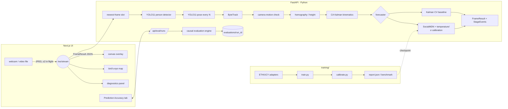

# MotionPredict AI

Real-time pedestrian detection, tracking and **probabilistic trajectory forecasting**, with a
**prediction-vs-reality evaluation engine** that measures how accurate those forecasts actually are.

A portfolio-grade ML engineering project: everything shown in the UI is computed by code that ran.
Forecasts come from a trained model or a labelled physics baseline, never from mock data. Probabilities
are called probabilities only when held-out calibration supports it. Every accuracy number is computed
on held-out data.

> Research prototype. Not a safety system, not for surveillance or identification. Track IDs are
> temporary and anonymous; no face recognition, no recording.

---

## What it does

| Area | Implementation |
|---|---|
| Video input | Browser webcam (permission + consent screen), local video files, labelled **dataset-replay demo**, optional RTSP/HTTP on the server (`MP_ALLOW_SERVER_SOURCES=1`) |
| Streaming | WebSocket, JPEG frames, ≤2 frames in flight, newest-frame slot on the server (stale frames dropped and counted), auto-reconnect. Pause stops browser sources client-side and sends `{"type":"pause"}` so a server-side (RTSP) source stops reading frames |
| Detection | Ultralytics **YOLO11n** (COCO person class), configurable confidence / NMS IoU / input size |
| Pose | **YOLO11n-pose** as a separate, timed stage every N frames; keypoints matched to boxes and carried forward with the box. The *pose estimation* setting (`config.pose`) switches the stage on or off; showing the skeleton is a separate display-only layer toggle |
| Tracking | ByteTrack-style two-stage association (own implementation, real timestamps), tentative → confirmed → lost lifecycle, tracker confidence. If timestamps jump backwards by more than 0.05 s (looped or seeked video, demo wrap-around), all per-person state is reset and the frame carries the warning *"Timestamps went backwards (video looped or seeked) - tracks were reset."* |
| Geometry | Ground-plane homography from a calibration wizard; horizon from H; approximate height via the single-view horizon ratio, **with an interval**, only when calibrated and the full body is visible |
| Kinematics | Constant-acceleration Kalman filter on the footpoint: velocity, speed, heading, acceleration, turn rate, movement state; px/s uncalibrated, m/s calibrated (+ walking-speed categories). Camera-motion check via optical flow |
| Forecasting | **A:** Kalman constant-velocity (+ CA variant) with uncertainty bands, no route probabilities. **B:** **SocialMDN**, a learned 5-mode Gaussian-mixture forecaster with social attention, trained on ETH/UCY |
| Calibration of outputs | Temperature scaling of mode probabilities + σ scaling + Kalman noise, all fitted on validation data; ECE / reliability / HDR coverage on held-out data |
| Observability | Per-stage events (timestamp, duration, inputs, outputs, confidence, errors) for every frame; browser overlay timing. Frame stats separate `compute_ms_mean` (worker start → done) from `queue_ms_mean` (receipt → worker start); `inference_fps` = 1000 / `compute_ms_mean`, `input_fps` is the arrival rate of frames from the source, and `processing_ms` is end-to-end (receipt → done) |
| Explanations | Deterministic rule-based summary; optional Claude summary of the same structured numbers (never the predictor) |
| Evaluation | Whole-recording, causal prediction-vs-reality engine: ADE/FDE, minADE/minFDE@K, wADE, miss rate, NLL, coverage, reliability, paired bootstrap, heatmaps, failure analysis, review-set export, CSV/JSON/HTML report |

## Architecture



Capture, inference and rendering are decoupled. The browser keeps sending only while fewer than two
frames are outstanding. The server processes only the newest pending frame. The overlay redraws at
display rate and shows the age of the result (stale results are labelled, not hidden).

### File tree

```
backend/motionpredict/
  server.py            FastAPI app: REST, /ws/stream, /ws/demo, evaluation API, static UI
  pipeline.py          per-session pipeline + StageRecorder (diagnostics events)
  detection.py         YOLO11 detector + separate pose pass
  tracking.py          ByteTrack-style tracker with lifecycle states
  kalman.py            CV / CA Kalman filters with variable dt
  kinematics.py        per-track state, resampling to the model's 0.4 s grid
  calibration.py       homography, horizon, height estimation with intervals
  camera_motion.py     background optical-flow camera-motion check
  forecasting/         constants, data adapters, model (SocialMDN), baselines, metrics, live service
  evaluation/          engine.py (causal runs), scoring.py (metric definitions), report.py (aggregation, CSV/HTML)
  explain.py           rule-based + optional LLM summaries
  demo.py              dataset replay (labelled demo mode)
  schemas.py           API / WebSocket contracts (mirrored in frontend/src/lib/types.ts)
backend/tests/         60 pytest tests incl. a causality proof and schema contract tests
training/              train.py, calibrate.py, evaluate.py, summarize.py
configs/model.yaml     model + training + baseline configuration
models/                checkpoints, per-fold report.json, benchmark.{json,md}
frontend/src/          Next.js app: live console, prediction-accuracy tab, model card
scripts/               download_data.sh, train_all_folds.sh
docs/examples/         example FrameResult, stored evaluation prediction and summary payloads (incl. the full ZARA1 engine-validation summary)
```

## Setup

Requirements: Python 3.11+, Node 20+. GPU optional.

```bash
python -m venv .venv
```

```bash
source .venv/bin/activate
```

```bash
pip install -r backend/requirements.txt && pip install -e backend
```

For NVIDIA CUDA, install the matching PyTorch wheel first (https://pytorch.org/get-started/locally/).
On Apple Silicon the default wheel includes MPS. The device is chosen automatically (CUDA → MPS → CPU)
and reported in the UI. Override it with `MP_DEVICE=cpu|cuda|mps`.

Pedestrian data (needed for the demo, training and annotated-scene evaluation; not committed):

```bash
scripts/download_data.sh
```

Build the UI once and run everything from one process at http://127.0.0.1:8000:

```bash
cd frontend && npm install && npm run build && cd ..
```

```bash
python -m motionpredict.server
```

Or develop the UI with hot reload at http://localhost:3000 (backend on :8000):

```bash
cd frontend && NEXT_PUBLIC_API_URL=http://127.0.0.1:8000 npm run dev
```

YOLO weights (`yolo11n.pt`, `yolo11n-pose.pt`) are downloaded by Ultralytics into `models/detector/` on
first start. Optional: set `ANTHROPIC_API_KEY` to enable LLM explanations (`MP_LLM_MODEL`, default
`claude-opus-5-5`).

Tests:

```bash
cd backend && pytest -q
```

```bash
cd frontend && npm test && npm run typecheck
```

At the time of writing: 60 backend tests and 9 frontend tests, all passing.

## Using it

1. **Live Console** → accept the privacy notice → *Start camera* or *Open video file…*. People get boxes, temporary IDs, trails, velocity/heading arrows and forecast paths (green / yellow / red by rank, dashed) with 2σ uncertainty cones and the age of each prediction.
2. *Demo replay* replays human-annotated ETH/UCY positions through the real tracker, kinematics and forecaster. The detector is bypassed and the image is a synthetic top-down rendering; the banner says so. The white dotted line is what actually happened.
3. *Calibrate…* opens the wizard: click ≥4 floor points with known positions (5+ lets the system measure its own error), optionally give the camera height or mark a reference object for heights. A projected 1 m grid and the horizon let you check it visually. Everything then switches to meters.
4. **Prediction Accuracy** → upload a video (or evaluate an annotated scene) → replay any stored forecast, press *Reveal future*, compare models, browse analytics and failure cases, export CSV/JSON/HTML.

## Methods

### Coordinates and units
* Uncalibrated: image pixels of the processed frame, y down. Speeds are px/s; heights are *unknown*, with relative image height shown instead.
* Calibrated: metric ground plane from the homography; m and m/s.
* The learned model is trained in meters at 2.5 Hz. Live tracks are Kalman-smoothed and resampled to the model's 0.4 s grid. In pixel mode the input is normalised by the median box height (1.7/h_px) only so the network sees plausible magnitudes. Outputs stay in pixels and are labelled **uncalibrated weights / out of distribution**.

### SocialMDN
GRU encoder over up to 8 past positions in a heading-aligned frame (rotation-equivariant by construction, which is tested). Single-head attention over up to 8 neighbours. Five learned modes, each a path plus per-step along/cross-track σ that is constrained to be non-decreasing. Loss: mixture NLL + winner-takes-all L2 + mode cross-entropy. Augmentation: rotations and reflections (which also covers the y-down image plane). Random history truncation is used so young tracks work.

### Probability calibration
Temperature T (mode logits) and a σ multiplier are fitted on a **temporal validation split** of the training scenes; the test scene is never touched. The UI calls mode values *probabilities* only when the checkpoint's held-out ECE over all modes is < 0.05 **and** its held-out top-mode ECE is < 0.10, **and** the live coordinates are metric ground-plane coordinates from a `calibrated_verified` camera calibration (or the dataset replay's exact virtual calibration). Otherwise they are *uncalibrated weights*, and `Forecast.calibration_status` states which condition failed. Of the five folds only zara2 passes the checkpoint gate; the active zara1 checkpoint fails it (top-mode ECE 0.19), so its mode values are always shown as uncalibrated weights. The physics baseline never produces route probabilities.

### Splits without leakage
Leave-one-scene-out across ETH, HOTEL, UNIV, ZARA1, ZARA2. Inside training scenes, windows entirely in the first 80% of the frame range are train and windows entirely in the last 20% are validation. Straddling windows are dropped. The deployed checkpoint is the **ZARA1-held-out** fold, so the ZARA1 demo and evaluation are on unseen data.

## Benchmarks (held-out scenes, meters, 4.8 s horizon)

Generated by `scripts/train_all_folds.sh` (`models/benchmark.md`). These are this repository's own
results, not quoted literature numbers.

| held-out scene | windows | CV ADE/FDE | Kalman-CV ADE/FDE | SocialMDN top-1 ADE/FDE | SocialMDN min-of-5 ADE/FDE | NLL/step Kalman / MDN | mode ECE (all modes) raw → calibrated | top-mode ECE calibrated | 90% HDR coverage @4.8s Kalman / MDN |
|---|---|---|---|---|---|---|---|---|---|
| eth | 320 | 1.05/2.24 | 1.03/2.16 | 1.01/2.08 | 0.73/1.42 | 3.34 / 2.50 | 0.112 → 0.102 | 0.168 | 0.62 / 0.53 |
| hotel | 1075 | 0.30/0.58 | 0.22/0.42 | 0.29/0.54 | 0.18/0.30 | 0.59 / -1.39 | 0.023 → 0.026 | 0.102 | 0.98 / 0.91 |
| univ | 23612 | 0.52/1.16 | 0.63/1.29 | 0.57/1.22 | 0.35/0.72 | 1.46 / -0.17 | 0.0564 → 0.0501 | 0.099 | 0.86 / 0.74 |
| zara1 | 2214 | 0.42/0.94 | 0.51/1.06 | 0.42/0.90 | 0.28/0.57 | 1.12 / -0.69 | 0.037 → 0.037 | 0.190 | 0.92 / 0.92 |
| zara2 | 5721 | 0.32/0.71 | 0.38/0.79 | 0.30/0.67 | 0.18/0.38 | 1.04 / -2.43 | 0.025 → 0.025 | 0.079 | 0.90 / 0.92 |
| **avg** | | 0.52/1.12 | 0.56/1.14 | 0.52/1.08 | 0.34/0.68 | | | | |

**Reading this honestly:**
* SocialMDN's single most-likely path is about as accurate as constant velocity, a known strong baseline on ETH/UCY.
* Its value is in multi-modality (min-of-5 errors ~35% lower) and in density quality (much lower NLL).
* Its uncertainty is reasonably calibrated on the ZARA/HOTEL scenes, but overconfident on UNIV (crowded) and ETH (out of distribution). Only zara2 passes the probability-calibration gate (all-modes ECE < 0.05 and top-mode ECE < 0.10); ETH fails both (all modes 0.102, top mode 0.168), UNIV fails on all-modes ECE (0.0501, just above 0.05), and HOTEL (0.102) and ZARA1 (0.190) fail on top-mode ECE (the most-likely mode is over-confident). Held-out 90% coverage at 4.8 s is 0.91–0.92 on HOTEL/ZARA1/ZARA2 but only 0.74 on UNIV and 0.53 on ETH.

Median single-track model inference latency is ~1 ms on CPU (4 cores) (see `latency_ms_single_window_median` in each `report.json`).

**Engine validation.** The evaluation engine was run on the full annotated ZARA1 scene (human ground truth, held out from the active checkpoint, through tracker + Kalman + resampling, one forecast per track per second). The run's metadata and aggregates are stored in `models/engine_validation_zara1.json`. It made 1,927 forecasts; 58 of 1,985 eligible track-instants got no forecast from at least one model (40 too little history, 18 learned model only) and are counted in `forecast_failures`. At 3 s, 1,500 forecasts were scored: baseline FDE 0.497 m vs SocialMDN top-1 0.495 m (paired difference −0.002 m, 95% CI [−0.013, 0.011]: no significant difference). SocialMDN best-of-5 FDE 0.298 m; its 90% region covers 0.918 of outcomes (50% region: 0.555). At 5 s (1,206 scored) SocialMDN top-1 is better: FDE 0.977 vs 1.030 m, paired difference −0.054 m, CI [−0.082, −0.026]. Mode ECE over all modes is 0.034 at 3 s, but the checkpoint's held-out top-mode ECE is 0.190, so these mode values are labelled uncalibrated weights. The full summary is in `docs/examples/eval_summary_zara1_full.json` (an earlier run with the same configuration); `docs/examples/eval_summary.json` is a 20 s excerpt and its numbers are noisier. This is consistent with the offline benchmark.

**Real video example.** On OpenCV's `vtest.avi` pedestrian sample (uncalibrated, tracker-derived pseudo ground truth, 439 forecasts), SocialMDN's top-1 path beats the Kalman baseline at all horizons (3 s FDE 0.84 vs 0.91 body heights, bootstrap CI excludes 0). However, its 90% regions cover only ~53% of outcomes in image coordinates, i.e. it is overconfident off its training domain. The UI shows exactly this.

## Prediction vs. reality evaluation

* **Causality.** Frames are processed once, in timestamp order. At each forecast time, both models predict from the session state at that instant and the record is appended to `predictions.jsonl` immediately. Future frames only attach the observed path afterwards. `test_forecasts_never_use_future_frames` proves it: two synthetic videos identical until 6 s and divergent afterwards produce byte-identical stored forecasts before 6 s, but different scores.
* **Ground truth.** Uploaded video: the tracker's later detections of the same track (*pseudo* ground truth, labelled as such). Annotated scenes: human labels.
* **Quality gates.** Samples are excluded, with the reason reported, for: track lost before the horizon, gaps > 0.6 s, implied speed jumps (likely ID switch), camera cuts (frame-difference detector; tracks reset), > 30% of future frames with camera motion, tracker confidence < 0.3 at forecast time, recording ended, or tracks the user flagged as inaccurate.
* **Metrics.** ADE/FDE of the top-1 path. minADE/minFDE@K, explicitly labelled as hindsight oracle. Probability-weighted ADE. Miss rate (2 m, or 1 body height in pixels). Final-position NLL. 50%/90% HDR coverage. Mode reliability diagram + ECE. Pixel errors are also reported in body heights so near and far people are comparable.
* **Fair comparison.** Both models are scored on identical samples, with a paired bootstrap 95% CI per horizon.
* **Reproducibility.** `run.json` stores the source SHA-256, model versions, calibration constants, pipeline config, quality rules, git revision and library versions. Re-runs with another checkpoint reuse the same source and config.
* **Improvement workflow.** Flag hard cases or inaccurate tracks, then export a review set: observation window + observed future, with optional corrected futures. Keep it in its own split. Never fine-tune on a recording and then report accuracy on that same recording.
* **Scope notes.** Only the `person` class is tracked, and the learned model is a pedestrian model. Other movers (a ball, players sprinting) are out of distribution. "Sport" and "camera perspective" are user-entered run tags for grouping, not automatic recognition.

## Privacy and safety

* Processing is local. Frames live in memory only; nothing is written to disk in the live console.
* Uploaded evaluation videos are deleted after analysis unless *keep video* is ticked. Stored results contain trajectories and metrics only.
* No face recognition, re-identification or identity inference. IDs are small session-local integers, cleared (with all buffers) when the session stops.
* Warnings are shown for an uncalibrated camera, camera motion, short histories, out-of-distribution use and stale results. Forecasts are never described as certain.
* The LLM receives only structured numbers (no images). It is instructed not to invent measurements or call uncalibrated weights probabilities, and the rule-based summary is always shown alongside it.

## Limitations

* CPU throughput is limited. Measured on 4 CPU cores with `vtest.avi` (768×576, 60 frames): YOLO11n detector median ~36 ms at 640 px and ~81 ms at 960 px; the pose stage ~83–91 ms on the frames where it runs (every 3rd by default). Mean compute per frame was 87 ms with pose (`inference_fps` ≈ 11.5) and 51 ms without (≈ 19.6) at 640 px, and 133 ms (≈ 7.5) with pose at 960 px. Raise `pose_every`, turn pose estimation off, lower the inference size, or use a GPU.
* Pixel-space forecasting is perspective-distorted; calibrate for meaningful metric forecasts and probabilities.
* Height estimation assumes small camera roll/tilt and uses the box top as the head top. It is an approximation with an interval, not a measurement.
* ETH/UCY is low-density, mostly straight walking. Crowds, sports and non-walking motion are out of distribution.
* Camera motion is detected and flagged but not compensated.

## Data and licenses

ETH (BIWI) and UCY (Crowds) pedestrian trajectories are distributed for research use by their authors and
are fetched from the Trajectron++ repository mirror by `scripts/download_data.sh`; they are not
redistributed here. Review their terms before other uses. The Stanford Drone Dataset was considered but
not used (different agent mix, top-down only, licensing). YOLO11 weights are Ultralytics models under
AGPL-3.0 (check whether that fits your use).
